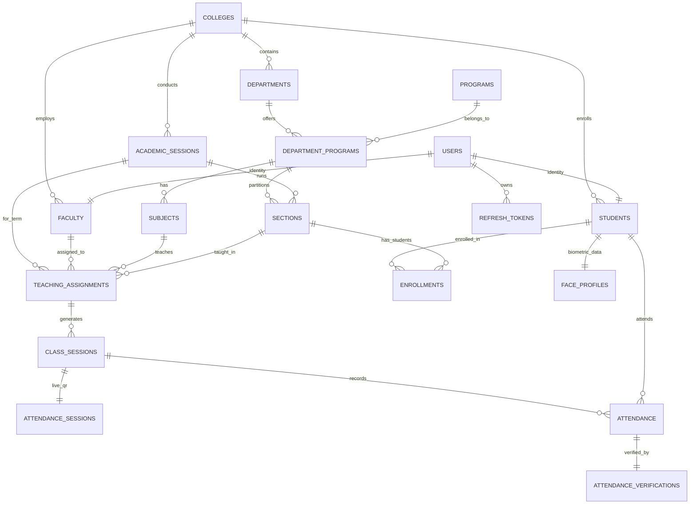

# Eduportal Backend v2 — Complete Progress & Architecture Documentation 📘
> **Comprehensive System Manual & Progress Report**  
> *Har ek file, technology, version aur component ka sui ke nok barabar complete vivaran.*

---

## 📑 Table of Contents (Vishy-Suchi)

1. [Project Overview & Metadata](#1-project-overview--metadata)
2. [Complete Technology Stack & Exact Versions](#2-complete-technology-stack--exact-versions)
3. [Configuration & Environment Management](#3-configuration--environment-management)
   - [application.yaml Configuration](#31-applicationyaml-breakdown)
   - [Environment Profiles (Dev vs Prod)](#32-environment-profiles-dev-vs-prod)
   - [Required Environment Variables (.env)](#33-required-environment-variables-env)
4. [Master File Inventory & Directory Structure](#4-master-file-inventory--directory-structure)
5. [Exhaustive File-by-File Technical Deep Dive](#5-exhaustive-file-by-file-technical-deep-dive)
   - [5.1 Root & Application Entry Point](#51-root--application-entry-point)
   - [5.2 Configuration Properties (`config/properties`)](#52-configuration-properties-configproperties)
   - [5.3 Security Infrastructure (`security/` & `config/`)](#53-security-infrastructure-security--config)
   - [5.4 Authentication Layer & DTOs (`auth/`)](#54-authentication-layer--dtos-auth)
   - [5.5 Domain Enums (`enums/`)](#55-domain-enums-enums)
   - [5.6 Base Classes & Soft Deletion (`models/`)](#56-base-classes--soft-deletion-models)
   - [5.7 Core Domain Entities (`models/`)](#57-core-domain-entities-models)
   - [5.8 Spring Data JPA Repositories (`repos/`)](#58-spring-data-jpa-repositories-repos)
   - [5.9 Exception Handling Framework (`exception/`)](#59-exception-handling-framework-exception)
6. [Database Schema & Entity Relationship (ER) Model](#6-database-schema--entity-relationship-er-model)
7. [Security & Authentication Flow Architecture](#7-security--authentication-flow-architecture)
   - [Stateless JWT Token Lifecycle](#71-stateless-jwt-token-lifecycle)
   - [Refresh Token Hashing & Rotation Strategy](#72-refresh-token-hashing--rotation-strategy)
   - [Spring Security Filter Chain Pipeline](#73-spring-security-filter-chain-pipeline)
8. [Git Commit History & Progress Log (Kaam Ka Hisab)](#8-git-commit-history--progress-log-kaam-ka-hisab)
9. [Feature Matrix: Kaam Jo Ho Chuka Hai vs Kaam Jo Baki Hai](#9-feature-matrix-kaam-jo-ho-chuka-hai-vs-kaam-jo-baki-hai)
10. [Known Issues, Discrepancies & Recommendations](#10-known-issues-discrepancies--recommendations)

---

## 1. Project Overview & Metadata

Eduportal Backend v2 ek modern, multi-institutional Academic & Smart Attendance Management ERP system hai. Yeh backend college/university ke pure academic structure (Colleges, Departments, Programs, Academic Sessions, Sections, Students, Faculty, Timetable/Class Sessions) ko manage karta hai aur multi-factor automated attendance (Dynamic QR Code + Geofencing GPS Coordinates + Face Biometrics) provide karne ke liye design kiya gaya hai.

### 📌 Project Metadata Table

| Property | Value | Description |
|---|---|---|
| **Project Name** | `eduportal-db` | Root Maven project name |
| **Group ID** | `in.ignishers` | Base enterprise package group |
| **Artifact ID** | `eduportal` | Binary build artifact name |
| **Version** | `0.0.1-SNAPSHOT` | Current project release milestone |
| **Root Package** | `in.ignishers.eduportal` | Base Java source package |
| **Java Version** | `17` (LTS) | Baseline Java runtime specification |
| **Spring Boot Version** | `4.1.1` (Spring Boot 4.x) | Next-generation Spring runtime |
| **Build Tool** | Apache Maven `3.9.16` | Automated build and dependency engine |
| **Maven Wrapper Version** | `3.3.4` | Self-contained executable wrapper (`./mvnw`) |
| **Servlet Context Path** | `/api` | Sabhi REST endpoints ka base prefix |
| **Default Server Port** | `8080` (overridable via `SERVER_PORT`) | Default HTTP network listener |
| **Database** | PostgreSQL 15+ | Relational Enterprise Database |

---

## 2. Complete Technology Stack & Exact Versions

Project me use hui har ek dependency, library aur plugin ka exact version aur uska uddeshya (purpose):

### 2.1 Core Runtime Dependencies (`pom.xml`)

| Library / Starter | Group ID : Artifact ID | Version | Scope | Kaam (Purpose & Role) |
|---|---|---|---|---|
| **Spring Boot Starter Parent** | `org.springframework.boot:spring-boot-starter-parent` | `4.1.1` | - | Pure project ke dependencies ka master parent BOM aur version management. |
| **Spring Data JPA** | `org.springframework.boot:spring-boot-starter-data-jpa` | Managed (`4.1.1`) | Compile | Hibernate 6/7 ORM, EntityManager, JPA Repositories, Transaction management. |
| **Jakarta Bean Validation** | `org.springframework.boot:spring-boot-starter-validation` | Managed (`4.1.1`) | Compile | Hibernate Validator engine (`@NotBlank`, `@Email`, `@Size`, `@Valid`). |
| **Spring Web MVC** | `org.springframework.boot:spring-boot-starter-webmvc` | Managed (`4.1.1`) | Compile | REST API controllers, Jackson JSON serializer, embedded Tomcat HTTP server. |
| **Spring Security** | `org.springframework.boot:spring-boot-starter-security` | Managed (`4.1.1`) | Compile | Filter chain, BCrypt password hashing, DaoAuthenticationProvider, role-based authorization. |
| **Spring Boot DevTools** | `org.springframework.boot:spring-boot-devtools` | Managed (`4.1.1`) | Runtime (Optional) | LiveReload aur hot-restart for fast local developer iteration. |
| **PostgreSQL Driver** | `org.postgresql:postgresql` | Managed | Runtime | PostgreSQL Database ke sath JDBC communication pipe. |
| **Project Lombok** | `org.projectlombok:lombok` | Managed | Compile (Optional) | Boilerplate code (`@Getter`, `@Setter`, `@RequiredArgsConstructor`) reduce karna. |
| **Dotenv Support** | `me.paulschwarz:springboot4-dotenv` | `5.1.0` | Compile (Optional) | Root folder me maujood `.env` file ko Spring Environment properties me bind karna. |
| **JJWT API** | `io.jsonwebtoken:jjwt-api` | `0.13.0` | Compile | JSON Web Token interfaces, Claims builder, parser specifications. |
| **JJWT Implementation** | `io.jsonwebtoken:jjwt-impl` | `0.13.0` | Runtime | JJWT parsing aur cryptographic signing algorithm implementation engine. |
| **JJWT Jackson** | `io.jsonwebtoken:jjwt-jackson` | `0.13.0` | Runtime | JWT token payloads ko JSON me serialize/deserialize karne ke liye Jackson adapter. |

### 2.2 Test Dependencies (`pom.xml`)

| Test Starter | Group ID : Artifact ID | Version | Scope | Role |
|---|---|---|---|---|
| **Spring Data JPA Test** | `org.springframework.boot:spring-boot-starter-data-jpa-test` | Managed | Test | Slice testing for Repositories, `@DataJpaTest`, in-memory test DB support. |
| **Validation Test** | `org.springframework.boot:spring-boot-starter-validation-test` | Managed | Test | Unit testing for DTO bean constraints without spinning up full servlet. |
| **Web MVC Test** | `org.springframework.boot:spring-boot-starter-webmvc-test` | Managed | Test | MockMvc slice testing for Controllers (`@WebMvcTest`). |
| **Spring Security Test** | `org.springframework.security:spring-security-test` | Managed | Test | Mocking security contexts (`@WithMockUser`), auth filter testing. |

### 2.3 Build Plugins (`pom.xml`)

1. **`spring-boot-maven-plugin`**: Executable fat-JAR packaging (`eduportal-0.0.1-SNAPSHOT.jar`) banata hai jisme embedded tomcat aur sabhi nested libraries package hoti hain.
2. **`maven-compiler-plugin`**: Java source code compile karta hai. Isme specifically `annotationProcessorPaths` configure ki gayi hai taaki Lombok bytecode compilation time par reliably execute ho (`default-compile` aur `default-testCompile` dono phases me).

---

## 3. Configuration & Environment Management

### 3.1 `application.yaml` Breakdown

Configuration file `src/main/resources/application.yaml` teen multi-document sections me partitioned hai:

```
[Common Defaults Document] ---> Sabhi profiles ke liye base configuration
           ├── [dev Profile Document]  ---> Development profile specific overrides
           └── [prod Profile Document] ---> Production profile strict security overrides
```

#### Detailed Common Configuration Settings:
- `spring.application.name`: `eduportal-db`
- `spring.profiles.active`: `[dev]` (Dev profile by default activated)
- `server.port`: `${SERVER_PORT:8080}` (Dynamic environment variable port, default fallback 8080)
- `server.servlet.context-path`: `/api` (Sabhi endpoints automatically `/api` se start hote hain)
- `spring.datasource.driver-class-name`: `org.postgresql.Driver`
- `spring.datasource.url`: `${DB_URL}` (PostgreSQL JDBC connection string)
- `spring.datasource.username`: `${DB_USERNAME}`
- `spring.datasource.password`: `${DB_PASSWORD}`
- `spring.jpa.open-in-view`: `false` (OSIV disabled hai taaki database connections view layer tak idle na rahein - best production practice!)
- `spring.jpa.properties.hibernate.format_sql`: `true`
- `spring.jpa.properties.hibernate.jdbc.time_zone`: `UTC` (Sabhi database timestamps UTC timezone me store hote hain)
- `spring.jackson.time-zone`: `UTC`
- `spring.jackson.default-property-inclusion`: `non_null` (JSON response me `null` fields serialize nahi hote, bandwidth bachti hai)
- `app.cors.allowed-origins`: `http://localhost:3000`, `http://localhost:5173` (React Vite & Next.js/CRA dev servers)
- `app.cors.allowed-methods`: `GET, POST, PUT, PATCH, DELETE, OPTIONS`
- `app.cors.allowed-headers`: `Authorization, Content-Type, Accept`
- `app.cors.allow-credentials`: `true` (Cookies & auth headers allowed across origins)
- `app.security.public-urls`: `/auth/login`, `/auth/register`, `/auth/refresh`, `/public/**`
- `app.jwt.secret`: `${JWT_SECRET}` (Cryptographic HMAC-SHA secret key)
- `app.jwt.access-token-expiration`: `900000` ms (15 Minutes)
- `app.jwt.refresh-token-expiration`: `2592000000` ms (30 Days)

### 3.2 Environment Profiles (Dev vs Prod)

| Configuration Item | `dev` Profile (Default Active) | `prod` Profile | Reason / Significance |
|---|---|---|---|
| **Hibernate DDL Auto** | `update` | `validate` | Dev me tables automatically ban jati hain ya update ho jati hain; Prod me schema freeze rehta hai taaki data loss na ho. |
| **Show SQL** | `true` | `false` | Dev me console par query print hoti hai debugging ke liye; Prod me log pollution aur data leak bachane ke liye band rehti hai. |
| **Root Logging Level** | `INFO` | `WARN` | Prod me sirf warnings/errors record hote hain. |
| **Application Log Level** | `DEBUG` | `INFO` | Dev me controller/service debugging enable rehti hai. |
| **Hibernate SQL Log Level** | `DEBUG` | Disabled | Parameter binding aur query tracing ke liye. |
| **Spring Security Log Level**| `INFO` | `WARN` | Authentication failures inspect karne ke liye. |

### 3.3 Required Environment Variables (`.env`)

Application start karne ke liye root directory me `.env` file honi chahiye ya system environment variables export hone chahiye:

| Variable Name | Required | Example Value | Description |
|---|---|---|---|
| `DB_URL` | **YES** | `jdbc:postgresql://localhost:5432/eduportal_db` | PostgreSQL connection URL |
| `DB_USERNAME` | **YES** | `postgres` | Database username |
| `DB_PASSWORD` | **YES** | `secret_password` | Database password |
| `JWT_SECRET` | **YES** | `404E635266556A586E3272357538782F413F4428472B4B6250645367566B5970` | 256-bit+ secure hex/base64 string for HMAC-SHA |
| `SERVER_PORT` | NO | `8080` (Default fallback) | Custom web server port |

---

## 4. Master File Inventory & Directory Structure

Project me total **48 files** hain (excluding `.git` and `.idea`). Yahan sabhi files ki directory-wise directory mapping hai:

```
eduportal-backend-v2/
├── .gitattributes                                  # Git line ending normalization
├── .gitignore                                      # Build artifacts & .env exclusions
├── .mvn/wrapper/
│   └── maven-wrapper.properties                   # Maven 3.9.16 distribution configuration
├── mvnw                                            # Unix executable shell script for Maven wrapper
├── mvnw.cmd                                        # Windows batch script for Maven wrapper
├── pom.xml                                         # Maven build configuration & dependencies
├── readme.md                                       # Minimal project readme
└── src/
    ├── main/
    │   ├── java/in/ignishers/eduportal/
    │   │   ├── EduportalBackendApplication.java    # Spring Boot Main Entry Point
    │   │   ├── auth/
    │   │   │   ├── AuthService.java                # Authentication logic (register, login, refresh)
    │   │   │   └── dto/
    │   │   │       ├── AuthResponse.java           # Record: JWT Access + Refresh token DTO
    │   │   │       ├── LoginRequest.java           # Record: Email + Password validation DTO
    │   │   │       ├── RefreshTokenRequest.java    # Record: Refresh token validation DTO
    │   │   │       └── RegisterRequest.java        # Record: Registration validation DTO
    │   │   ├── config/
    │   │   │   ├── SecurityConfig.java             # Spring Security 6 filter chain configuration
    │   │   │   └── properties/
    │   │   │       ├── CorsProperties.java         # Type-safe @ConfigurationProperties for CORS
    │   │   │       ├── JwtProperties.java          # Type-safe @ConfigurationProperties for JWT
    │   │   │       └── SecurityProperties.java     # Type-safe @ConfigurationProperties for Security
    │   │   ├── enums/
    │   │   │   ├── AttendanceStatus.java           # Enum: PRESENT, ABSENT, LATE
    │   │   │   ├── ClassStatus.java                # Enum: SCHEDULED, ONGOING, COMPLETED, CANCELLED
    │   │   │   ├── UserRole.java                   # Enum: ADMIN, FACULTY, STUDENT
    │   │   │   └── VerificationStatus.java         # Enum: PENDING, VERIFIED, FAILED
    │   │   ├── exception/
    │   │   │   ├── ApiErrorResponse.java           # Record: Standardized API error payload
    │   │   │   ├── GlobalExceptionHandler.java     # @RestControllerAdvice global exception catcher
    │   │   │   └── custom/
    │   │   │       ├── EmailAlreadyExistsException.java # Custom 409 Conflict exception
    │   │   │       ├── ResourceNotFoundException.java   # Custom 404 Not Found exception
    │   │   │       └── TokenRefreshException.java       # Custom 401 Unauthorized exception
    │   │   ├── models/
    │   │   │   ├── BaseEntity.java                 # MappedSuperclass: id, createdAt, updatedAt
    │   │   │   ├── SoftDeletableEntity.java        # MappedSuperclass: deleted boolean flag
    │   │   │   ├── User.java                       # Entity: users table
    │   │   │   ├── RefreshToken.java               # Entity: refresh_tokens table
    │   │   │   ├── College.java                    # Entity: colleges table
    │   │   │   ├── Department.java                 # Entity: departments table
    │   │   │   ├── Program.java                    # Entity: programs table
    │   │   │   ├── DepartmentProgram.java          # Entity: department_programs table
    │   │   │   ├── Subject.java                    # Entity: subjects table
    │   │   │   ├── AcademicSession.java            # Entity: academic_sessions table
    │   │   │   ├── Section.java                    # Entity: sections table
    │   │   │   ├── Student.java                    # Entity: students table
    │   │   │   ├── Faculty.java                    # Entity: faculty table
    │   │   │   ├── Enrollment.java                 # Entity: enrollments table
    │   │   │   ├── TeachingAssignment.java         # Entity: teaching_assignments table
    │   │   │   ├── ClassSession.java               # Entity: class_sessions table
    │   │   │   ├── AttendanceSession.java          # Entity: attendance_sessions table
    │   │   │   ├── Attendance.java                 # Entity: attendance table
    │   │   │   ├── AttendanceVerification.java     # Entity: attendance_verifications table
    │   │   │   └── FaceProfile.java                # Entity: face_profiles table
    │   │   ├── repos/
    │   │   │   ├── RefreshTokenRepository.java     # JpaRepository for RefreshToken
    │   │   │   └── UserRepository.java             # JpaRepository for User
    │   │   └── security/
    │   │       ├── JwtAuthenticationFilter.java    # OncePerRequestFilter for Bearer token extraction
    │   │       ├── JwtService.java                 # JJWT token generation, parsing & validation
    │   │       ├── RestAccessDeniedHandler.java    # AccessDeniedHandler (403 Forbidden JSON)
    │   │       ├── RestAuthenticationEntryPoint.java # AuthenticationEntryPoint (401 Unauthorized JSON)
    │   │       ├── UserPrincipal.java              # UserDetails implementation wrapping User entity
    │   │       └── UserPrincipalService.java       # UserDetailsService loading user by email
    │   └── resources/
    │       └── application.yaml                    # Main multi-profile application configuration
    └── test/
        └── java/in/ignishers/eduportal/
            └── EduportalBackendApplicationTests.java # Default Spring context smoke test
```

---

## 5. Exhaustive File-by-File Technical Deep Dive

Har ek class, interface, enum aur configuration file ka exact internal code aur uska role:

### 5.1 Root & Application Entry Point

#### 📄 `EduportalBackendApplication.java`
- **Path**: `src/main/java/in/ignishers/eduportal/EduportalBackendApplication.java`
- **Annotations**:
  - `@SpringBootApplication`: Component scanning, autoconfiguration aur property support trigger karta hai.
  - `@ConfigurationPropertiesScan`: Sub-packages ke andar jitne bhi `@ConfigurationProperties` classes hain unhe automatically discover aur register karta hai.
- **Methods**:
  - `public static void main(String[] args)`: Application bootstrap karta hai using `SpringApplication.run(EduportalBackendApplication.class, args)`.

---

### 5.2 Configuration Properties (`config/properties`)

#### 📄 `CorsProperties.java`
- **Path**: `src/main/java/in/ignishers/eduportal/config/properties/CorsProperties.java`
- **Annotation**: `@ConfigurationProperties(prefix = "app.cors")`, `@Component`, `@Getter`, `@Setter`
- **Fields**:
  - `List<String> allowedOrigins`: Frontend URLs (e.g., `http://localhost:3000`, `http://localhost:5173`)
  - `List<String> allowedMethods`: Allowed HTTP Verbs (`GET, POST, PUT, PATCH, DELETE, OPTIONS`)
  - `List<String> allowedHeaders`: Allowed HTTP Request Headers (`Authorization, Content-Type, Accept`)
  - `boolean allowCredentials`: Cross-origin cookie/credential sharing flag.

#### 📄 `JwtProperties.java`
- **Path**: `src/main/java/in/ignishers/eduportal/config/properties/JwtProperties.java`
- **Annotation**: `@ConfigurationProperties(prefix = "app.jwt")`, `@Component`, `@Getter`, `@Setter`
- **Fields**:
  - `String secret`: Cryptographic signature secret key (HMAC-SHA).
  - `long accessTokenExpiration`: Access token validity duration in milliseconds (`900000` = 15 minutes).
  - `long refreshTokenExpiration`: Refresh token validity duration in milliseconds (`2592000000` = 30 days).

#### 📄 `SecurityProperties.java`
- **Path**: `src/main/java/in/ignishers/eduportal/config/properties/SecurityProperties.java`
- **Annotation**: `@ConfigurationProperties(prefix = "app.security")`, `@Component`, `@Getter`, `@Setter`
- **Fields**:
  - `List<String> publicUrls`: Endpoints list jinhe authentication filter bypass karta hai (`/auth/login`, `/auth/register`, `/auth/refresh`, `/public/**`).

---

### 5.3 Security Infrastructure (`security/` & `config/`)

#### 📄 `SecurityConfig.java`
- **Path**: `src/main/java/in/ignishers/eduportal/config/SecurityConfig.java`
- **Annotations**: `@Configuration`, `@EnableWebSecurity`, `@EnableMethodSecurity`, `@RequiredArgsConstructor`
- **Injected Beans**: `CorsProperties`, `SecurityProperties`, `UserPrincipalService`, `JwtAuthenticationFilter`, `RestAuthenticationEntryPoint`, `RestAccessDeniedHandler`.
- **Created Beans**:
  - `passwordEncoder()`: Returns `new BCryptPasswordEncoder()`. Passwords ko one-way secure hash karta hai.
  - `authenticationProvider(PasswordEncoder)`: Returns `DaoAuthenticationProvider(userPrincipalService)` jisme BCrypt password encoder attach hota hai.
  - `authenticationManager(AuthenticationConfiguration)`: Spring standard AuthenticationManager expose karta hai jo login flow me use hota hai.
  - `corsConfigurationSource()`: `CorsProperties` ke basis par `UrlBasedCorsConfigurationSource` register karta hai sabhi paths (`/**`) ke liye.
  - `securityFilterChain(HttpSecurity, AuthenticationProvider, CorsConfigurationSource)`: Pure web security flow ko assemble karta hai:
    - Stateless Session (`SessionCreationPolicy.STATELESS`)
    - CSRF disabled
    - CORS configured
    - Public URLs permitAll
    - Exception handling entry points attached
    - `JwtAuthenticationFilter` placed before `UsernamePasswordAuthenticationFilter`.

#### 📄 `JwtService.java`
- **Path**: `src/main/java/in/ignishers/eduportal/security/JwtService.java`
- **Annotations**: `@Service`, `@RequiredArgsConstructor`
- **Cryptographic Engine**: JJWT `0.13.0` using `Keys.hmacShaKeyFor(secret.getBytes(UTF_8))`
- **Methods**:
  - `generateAccessToken(User user)`: Access token build karta hai claims ke sath:
    - Subject (`sub`): User email
    - Claim `userId`: User primary key ID
    - Claim `role`: User role name (`ADMIN`, `FACULTY`, `STUDENT`)
    - `issuedAt`: Current instant
    - `expiration`: `now + 15 minutes`
    - Signature: HMAC-SHA key
  - `extractEmail(String token)`: Token ke subject se user email return karta hai.
  - `extractUserId(String token)`: Token se `userId` claim extract karta hai.
  - `extractRole(String token)`: Token se `role` claim extract karta hai.
  - `isTokenValid(String token, UserDetails userDetails)`: Match karta hai email == `userDetails.getUsername()` aur check karta hai token expired na ho.
  - `isTokenExpired(String token)`: Expiration date ko current system time se compare karta hai.
  - `extractExpiration(String token)`: Expiration timestamp parse karta hai.
  - `extractAllClaims(String token)`: JJWT Parser se token decrypt aur verify karta hai.
  - `getAccessTokenExpirationSeconds()`: Expiration in seconds return karta hai (Response DTO ke liye).
  - `getRefreshTokenExpiration()`: Raw refresh token expiration duration in ms.

#### 📄 `JwtAuthenticationFilter.java`
- **Path**: `src/main/java/in/ignishers/eduportal/security/JwtAuthenticationFilter.java`
- **Extends**: `OncePerRequestFilter`
- **Flow**:
  1. Har incoming request se `Authorization` header read karta hai.
  2. Check karta hai agar header null hai ya `Bearer ` se start nahi hota, toh chain aage pass kar deta hai.
  3. Header se JWT substring nikalta hai (`token = authHeader.substring(7)`).
  4. `jwtService.extractEmail(token)` se email extract karta hai.
  5. Agar email valid hai aur current `SecurityContextHolder.getContext().getAuthentication()` null hai:
     - `userPrincipalService.loadUserByUsername(email)` se user details load karta hai.
     - `jwtService.isTokenValid(token, userDetails)` check karta hai.
     - Valid hone par `UsernamePasswordAuthenticationToken` create karke `SecurityContext` me set kar deta hai.
  6. Request execution controller tak proceed karti hai.

#### 📄 `UserPrincipal.java`
- **Path**: `src/main/java/in/ignishers/eduportal/security/UserPrincipal.java`
- **Implements**: `UserDetails`
- **Fields**: `User user` (Entity wrapper)
- **Methods**:
  - `getAuthorities()`: Returns `Collections.singletonList(new SimpleGrantedAuthority("ROLE_" + user.getRole().name()))`.
  - `getPassword()`: Returns `user.getPasswordHash()`.
  - `getUsername()`: Returns `user.getEmail()`.
  - `isAccountNonExpired()`, `isAccountNonLocked()`, `isCredentialsNonExpired()`: return `true`.
  - `isEnabled()`: Returns `user.isActive()`.
  - Helper getter `getId()`: User primary key ID return karta hai.

#### 📄 `UserPrincipalService.java`
- **Path**: `src/main/java/in/ignishers/eduportal/security/UserPrincipalService.java`
- **Implements**: `UserDetailsService`
- **Methods**:
  - `loadUserByUsername(String email)`: `userRepository.findByEmail(email)` call karta hai. User na milne par `UsernameNotFoundException("User not found with email: " + email)` throw karta hai. Success par `new UserPrincipal(user)` return karta hai.

#### 📄 `RestAuthenticationEntryPoint.java`
- **Path**: `src/main/java/in/ignishers/eduportal/security/RestAuthenticationEntryPoint.java`
- **Implements**: `AuthenticationEntryPoint`
- **Kaam**: Jab koi unauthenticated user protected resource access karta hai, toh default HTML 401 error page ke bajaye standard JSON API error payload return karta hai (`HttpStatus.UNAUTHORIZED - 401`).
- **Response Format**: `ApiErrorResponse(401, "Unauthorized", "Authentication is required to access this resource")` serialized via Jackson `ObjectMapper`.

#### 📄 `RestAccessDeniedHandler.java`
- **Path**: `src/main/java/in/ignishers/eduportal/security/RestAccessDeniedHandler.java`
- **Implements**: `AccessDeniedHandler`
- **Kaam**: Jab koi authenticated user unauthorized resource access karne ki koshish karta hai (e.g. Student trying to access Admin endpoint), toh 403 Forbidden JSON return karta hai.
- **Response Format**: `ApiErrorResponse(403, "Forbidden", "You do not have permission to access this resource")`.

---

### 5.4 Authentication Layer & DTOs (`auth/`)

#### 📄 `AuthService.java`
- **Path**: `src/main/java/in/ignishers/eduportal/auth/AuthService.java`
- **Annotations**: `@Service`, `@RequiredArgsConstructor`
- **Security Features**:
  - `SecureRandom`: 64-byte high-entropy cryptographically secure tokens generate karta hai.
  - `SHA-256 Hashing`: Database me raw refresh token kabhi store nahi hota! Raw token ka SHA-256 hash database me persist hota hai. Agar database leak bhi ho jaye, koi refresh token steal nahi kar sakta.
- **Core Operations**:
  1. `register(RegisterRequest request)`:
     - Email normalize karta hai (`trim().toLowerCase()`).
     - Check karta hai `userRepository.existsByEmail(email)`. Agar true hai toh `EmailAlreadyExistsException` throw karta hai.
     - New `User` entity create karta hai, password BCrypt se hash karta hai, default role `UserRole.STUDENT` assign karta hai, `active=true`.
     - User save karta hai.
     - `jwtService.generateAccessToken(user)` se access token banata hai.
     - New secure 64-byte refresh token generate karta hai, uska SHA-256 hash banakar database me save karta hai.
     - Returns `AuthResponse`.
  2. `login(LoginRequest request)`:
     - `authenticationManager.authenticate(new UsernamePasswordAuthenticationToken(email, request.password()))` se credentials verify karta hai.
     - `userRepository.findByEmail(email)` se user fetch karta hai.
     - Fresh access token aur rotated refresh token create karke `AuthResponse` return karta hai.
  3. `refresh(RefreshTokenRequest request)`:
     - Incoming raw refresh token ka SHA-256 hash calculate karta hai.
     - `refreshTokenRepository.findByTokenHash(hash)` se lookup karta hai.
     - Validation: Agar token nahi mila, ya `isRevoked() == true`, ya `getExpiresAt().isBefore(Instant.now())` hai toh `TokenRefreshException` throw karta hai.
     - Token Rotation: Old refresh token ko turant revoke kar deta hai (`oldToken.setRevoked(true)`).
     - New refresh token create karta hai aur user ke liye new access token issue karta hai.
  4. `logout(String refreshTokenRaw)`:
     - Incoming token ka hash nikal kar database me lookup karta hai aur `token.setRevoked(true)` mark kar deta hai.
  5. `revokeAllUserTokens(Long userId)`:
     - User ke sabhi active sessions terminate karne ke liye `refreshTokenRepository.deleteAllByUserId(userId)` trigger karta hai.

#### 📄 `AuthResponse.java` (Record)
- **Path**: `src/main/java/in/ignishers/eduportal/auth/dto/AuthResponse.java`
- **Fields**: `String accessToken`, `String refreshToken`, `String tokenType` (e.g. "Bearer"), `long expiresIn` (seconds).

#### 📄 `LoginRequest.java` (Record)
- **Path**: `src/main/java/in/ignishers/eduportal/auth/dto/LoginRequest.java`
- **Validation**:
  - `@NotBlank(message = "Email is required")`
  - `@Email(message = "Please provide a valid email address")`
  - `@NotBlank(message = "Password is required")`

#### 📄 `RegisterRequest.java` (Record)
- **Path**: `src/main/java/in/ignishers/eduportal/auth/dto/RegisterRequest.java`
- **Validation**:
  - `@NotBlank(message = "Email is required")`
  - `@Email(message = "Please provide a valid email address")`
  - `@NotBlank(message = "Password is required")`
  - `@Size(min = 8, max = 24, message = "Password must be between 8 and 24 characters")`

#### 📄 `RefreshTokenRequest.java` (Record)
- **Path**: `src/main/java/in/ignishers/eduportal/auth/dto/RefreshTokenRequest.java`
- **Validation**:
  - `@NotBlank(message = "Refresh token is required")`

---

### 5.5 Domain Enums (`enums/`)

1. **`UserRole.java`**:
   - Values: `ADMIN` (College/System administrator), `FACULTY` (Teacher/Professor), `STUDENT` (Enrolled student).
2. **`AttendanceStatus.java`**:
   - Values: `PRESENT` (Time par present), `ABSENT` (Unexcused or absent), `LATE` (Class shuru hone ke grace period ke baad mark kiya).
3. **`ClassStatus.java`**:
   - Values: `SCHEDULED` (Timetable me booked), `ONGOING` (Class session chalu hai), `COMPLETED` (Faculty ne session end kar diya), `CANCELLED` (Session cancel ho gaya).
4. **`VerificationStatus.java`**:
   - Values: `PENDING` (Verification in progress), `VERIFIED` (QR + Location + Face all verified), `FAILED` (Spoofed GPS ya face mismatch).

---

### 5.6 Base Classes & Soft Deletion (`models/`)

#### 📄 `BaseEntity.java`
- **Path**: `src/main/java/in/ignishers/eduportal/models/BaseEntity.java`
- **Annotation**: `@MappedSuperclass`, `@Getter`, `@Setter`
- **Fields**:
  - `@Id @GeneratedValue(strategy = GenerationType.IDENTITY) private Long id`: Auto-incrementing 64-bit BigInt Primary Key.
  - `@CreationTimestamp @Column(nullable = false, updatable = false) private LocalDateTime createdAt`: Entity create hone ka automatic UTC timestamp.
  - `@UpdateTimestamp @Column(nullable = false) private LocalDateTime updatedAt`: Entity modify hone par automatically update hone wala timestamp.

#### 📄 `SoftDeletableEntity.java`
- **Path**: `src/main/java/in/ignishers/eduportal/models/SoftDeletableEntity.java`
- **Extends**: `BaseEntity`
- **Annotation**: `@MappedSuperclass`, `@Getter`, `@Setter`
- **Fields**:
  - `@Column(nullable = false) private boolean deleted = false`: Logical delete flag. Real physical database delete ke bajaye row preserve rehti hai aur `deleted = true` mark ho jati hai.

---

### 5.7 Core Domain Entities (`models/`)

#### 1. `User.java` (Table: `users`)
- Base account representation for security and authentication.
- **Fields**:
  - `email` (VARCHAR 255, NOT NULL, UNIQUE)
  - `passwordHash` (VARCHAR, NOT NULL) — BCrypt hash
  - `role` (`UserRole`, VARCHAR 20, NOT NULL)
  - `active` (BOOLEAN, NOT NULL, default `true`)

#### 2. `RefreshToken.java` (Table: `refresh_tokens`)
- Stored session tokens.
- **Fields**:
  - `user` (`@ManyToOne(fetch = FetchType.LAZY) User`)
  - `tokenHash` (VARCHAR 255, NOT NULL, UNIQUE, Indexed via `idx_refresh_token_hash`)
  - `expiresAt` (Instant, NOT NULL)
  - `revoked` (BOOLEAN, NOT NULL, default `false`)

#### 3. `College.java` (Table: `colleges`, Extends: `SoftDeletableEntity`)
- Higher education institution.
- **Fields**:
  - `name` (VARCHAR 150, NOT NULL)
  - `code` (VARCHAR 20, NOT NULL, UNIQUE)
  - `address` (VARCHAR 255)

#### 4. `Department.java` (Table: `departments`, Extends: `SoftDeletableEntity`)
- Academic department (e.g., Computer Science, Mechanical).
- **Unique Constraint**: `(college_id, code)`
- **Fields**:
  - `college` (`@ManyToOne College`)
  - `name` (VARCHAR 100, NOT NULL)
  - `code` (VARCHAR 20, NOT NULL)

#### 5. `Program.java` (Table: `programs`, Extends: `SoftDeletableEntity`)
- Degree or course of study (e.g., B.Tech, MCA, MBA).
- **Fields**:
  - `name` (VARCHAR 100, NOT NULL, UNIQUE)
  - `code` (VARCHAR 20, NOT NULL, UNIQUE)

#### 6. `DepartmentProgram.java` (Table: `department_programs`, Extends: `SoftDeletableEntity`)
- Join mapping between a Department and a Program.
- **Unique Constraint**: `(department_id, program_id)`
- **Fields**:
  - `department` (`@ManyToOne Department`)
  - `program` (`@ManyToOne Program`)

#### 7. `Subject.java` (Table: `subjects`, Extends: `SoftDeletableEntity`)
- Academic subject/course curriculum item.
- **Unique Constraint**: `(department_program_id, code)`
- **Fields**:
  - `departmentProgram` (`@ManyToOne DepartmentProgram`)
  - `code` (VARCHAR 20, NOT NULL)
  - `name` (VARCHAR 100, NOT NULL)
  - `semester` (INTEGER, NOT NULL)
  - `credits` (INTEGER, NOT NULL)

#### 8. `AcademicSession.java` (Table: `academic_sessions`, Extends: `SoftDeletableEntity`)
- School/college term or year (e.g., 2025-2026 Odd Semester).
- **Unique Constraint**: `(college_id, name)`
- **Fields**:
  - `college` (`@ManyToOne College`)
  - `name` (VARCHAR 50, NOT NULL)
  - `startDate` (LocalDate, NOT NULL)
  - `endDate` (LocalDate, NOT NULL)
  - `current` (BOOLEAN, NOT NULL, default `false`)

#### 9. `Section.java` (Table: `sections`, Extends: `SoftDeletableEntity`)
- Division of students within a semester/program (e.g., Section A).
- **Fields**:
  - `departmentProgram` (`@ManyToOne DepartmentProgram`)
  - `academicSession` (`@ManyToOne AcademicSession`)
  - `semester` (INTEGER, NOT NULL)
  - `name` (VARCHAR 10, NOT NULL)

#### 10. `Student.java` (Table: `students`, Extends: `SoftDeletableEntity`)
- Detailed profile for a student user.
- **Unique Constraint**: `(college_id, enrollment_number)`
- **Fields**:
  - `user` (`@OneToOne User`, NOT NULL, UNIQUE)
  - `college` (`@ManyToOne College`, NOT NULL)
  - `department` (`@ManyToOne Department`, NOT NULL)
  - `enrollmentNumber` (VARCHAR 30, NOT NULL)
  - `firstName` (VARCHAR 50, NOT NULL)
  - `lastName` (VARCHAR 50, NOT NULL)
  - `phone` (VARCHAR 15)
  - `admissionYear` (INTEGER, NOT NULL)

#### 11. `Faculty.java` (Table: `faculty`, Extends: `SoftDeletableEntity`)
- Detailed profile for a teacher/faculty user.
- **Unique Constraint**: `(college_id, employee_number)`
- **Fields**:
  - `user` (`@OneToOne User`, NOT NULL, UNIQUE)
  - `college` (`@ManyToOne College`, NOT NULL)
  - `department` (`@ManyToOne Department`, NOT NULL)
  - `employeeNumber` (VARCHAR 30, NOT NULL)
  - `firstName` (VARCHAR 50, NOT NULL)
  - `lastName` (VARCHAR 50, NOT NULL)
  - `phone` (VARCHAR 15)
  - `designation` (VARCHAR 50, NOT NULL)

#### 12. `Enrollment.java` (Table: `enrollments`, Extends: `BaseEntity`)
- Maps a student to an academic section.
- **Unique Constraint**: `(student_id, section_id)`
- **Fields**:
  - `student` (`@ManyToOne Student`)
  - `section` (`@ManyToOne Section`)

#### 13. `TeachingAssignment.java` (Table: `teaching_assignments`, Extends: `BaseEntity`)
- Assigns a faculty member to teach a subject in a specific section.
- **Unique Constraint**: `(faculty_id, subject_id, section_id, academic_session_id)`
- **Fields**:
  - `faculty` (`@ManyToOne Faculty`)
  - `subject` (`@ManyToOne Subject`)
  - `section` (`@ManyToOne Section`)
  - `academicSession` (`@ManyToOne AcademicSession`)

#### 14. `ClassSession.java` (Table: `class_sessions`, Extends: `BaseEntity`)
- An individual timetable lecture event.
- **Fields**:
  - `teachingAssignment` (`@ManyToOne TeachingAssignment`)
  - `classDate` (LocalDate, NOT NULL)
  - `startTime` (LocalTime, NOT NULL)
  - `endTime` (LocalTime, NOT NULL)
  - `room` (VARCHAR 20)
  - `status` (`ClassStatus`, NOT NULL, default `SCHEDULED`)

#### 15. `AttendanceSession.java` (Table: `attendance_sessions`, Extends: `BaseEntity`)
- Live QR code generation session for an active class.
- **Unique Constraint**: `(class_id)`
- **Fields**:
  - `classSession` (`@OneToOne ClassSession`, UNIQUE)
  - `secret` (VARCHAR 255, NOT NULL, UNIQUE) — Rolling QR payload
  - `startedAt` (LocalDateTime, NOT NULL)
  - `expiresAt` (LocalDateTime, NOT NULL)
  - `active` (BOOLEAN, NOT NULL, default `true`)

#### 16. `Attendance.java` (Table: `attendance`, Extends: `BaseEntity`)
- Student attendance record for a class session.
- **Unique Constraint**: `(class_id, student_id)`
- **Fields**:
  - `classSession` (`@ManyToOne ClassSession`)
  - `student` (`@ManyToOne Student`)
  - `status` (`AttendanceStatus`, NOT NULL)
  - `markedAt` (LocalDateTime, NOT NULL)
  - `verification` (`@OneToOne AttendanceVerification`, cascade `ALL`)

#### 17. `AttendanceVerification.java` (Table: `attendance_verifications`, Extends: `BaseEntity`)
- Multi-factor audit trail for attendance legitimacy.
- **Fields**:
  - `attendance` (`@OneToOne Attendance`, UNIQUE)
  - `qrVerified` (BOOLEAN, NOT NULL, default `false`)
  - `latitude` (BigDecimal precision 10, scale 7)
  - `longitude` (BigDecimal precision 10, scale 7)
  - `faceVerified` (BOOLEAN, NOT NULL, default `false`)
  - `status` (`VerificationStatus`, NOT NULL, default `PENDING`)
  - `verifiedAt` (LocalDateTime)

#### 18. `FaceProfile.java` (Table: `face_profiles`, Extends: `BaseEntity`)
- Biometric facial feature embeddings for AI face verification.
- **Unique Constraint**: `(student_id)`
- **Fields**:
  - `student` (`@OneToOne Student`, UNIQUE)
  - `embedding` (`@Lob byte[]`, NOT NULL) — 128D/512D facial embedding vector
  - `modelVersion` (VARCHAR 50, NOT NULL) — e.g., "facenet-v1", "insightface-r100"
  - `active` (BOOLEAN, NOT NULL, default `true`)
  - `enrolledAt` (LocalDateTime, NOT NULL)

---

### 5.8 Spring Data JPA Repositories (`repos/`)

#### 📄 `UserRepository.java`
- **Extends**: `JpaRepository<User, Long>`
- **Methods**:
  - `Optional<User> findByEmail(String email)`: Used during login and JWT token validation.
  - `boolean existsByEmail(String email)`: Used during registration to prevent duplicate signups.

#### 📄 `RefreshTokenRepository.java`
- **Extends**: `JpaRepository<RefreshToken, Long>`
- **Methods**:
  - `Optional<RefreshToken> findByTokenHash(String tokenHash)`: Look up token record using SHA-256 hash.
  - `List<RefreshToken> findAllByUserId(Long userId)`: Fetch all active sessions for a user.
  - `void deleteAllByUserId(Long userId)`: Delete all sessions when logging out of all devices.

---

### 5.9 Exception Handling Framework (`exception/`)

#### 📄 `ApiErrorResponse.java` (Record)
- **Fields**:
  - `LocalDateTime timestamp`: ISO-8601 UTC timestamp.
  - `int status`: HTTP status code (400, 401, 403, 404, 409, 500).
  - `String error`: HTTP status reason phrase (e.g., "Unauthorized", "Not Found").
  - `String message`: Descriptive human-readable error explanation.
  - `Map<String, String> validationErrors`: Field-by-field validation error map (e.g., `{"email": "Please provide a valid email address"}`).
- **Static Factory**:
  - `ApiErrorResponse.validation(Map<String, String> errors)`: Automatically creates 400 Bad Request with populated validation errors.

#### 📄 `GlobalExceptionHandler.java`
- **Annotation**: `@RestControllerAdvice`
- **Handles**:
  1. `MethodArgumentNotValidException` ➔ Returns `400 BAD_REQUEST` with validation error map.
  2. `BadCredentialsException` ➔ Returns `401 UNAUTHORIZED` with message `"Invalid email or password"`.
  3. `DisabledException` ➔ Returns `403 FORBIDDEN` with message `"User account is disabled"`.
  4. `LockedException` ➔ Returns `403 FORBIDDEN` with message `"User account is locked"`.
  5. `EmailAlreadyExistsException` ➔ Returns `409 CONFLICT` with dynamic message.
  6. `ResourceNotFoundException` ➔ Returns `404 NOT_FOUND` with dynamic message.
  7. `TokenRefreshException` ➔ Returns `401 UNAUTHORIZED` with dynamic message.
  8. `Exception.class` (Catch-all) ➔ Returns `500 INTERNAL_SERVER_ERROR` with message `"An unexpected error occurred"`.

#### Custom Exception Classes:
- `EmailAlreadyExistsException`: Extends `RuntimeException`. Thrown when an email is already registered.
- `ResourceNotFoundException`: Extends `RuntimeException`. Thrown when an entity cannot be found.
- `TokenRefreshException`: Extends `RuntimeException`. Thrown when a refresh token is invalid, revoked, or expired.

---

## 6. Database Schema & Entity Relationship (ER) Model



---

## 7. Security & Authentication Flow Architecture

### 7.1 Stateless JWT Token Lifecycle

```
[Client / React App]                    [Spring Boot Backend]                  [Database]
       │                                          │                                │
       ├───── 1. POST /api/auth/login ───────────>│                                │
       │      (email, password)                   ├──── 2. Authenticate User ─────>│
       │                                          │<─── 3. Return User Entity ─────┤
       │                                          │                                │
       │                                          ├──── 4. Create Access Token     │
       │                                          │        (15 mins, signed)       │
       │                                          │                                │
       │                                          ├──── 5. Generate Refresh Token  │
       │                                          │        (64 bytes SecureRandom) │
       │                                          │                                │
       │                                          ├──── 6. Hash with SHA-256 ─────>│ (Store Hash)
       │                                          │                                │
       │<──── 7. Return AuthResponse ─────────────┤                                │
       │      (accessToken, refreshToken, 900s)   │                                │
       │                                          │                                │
       │                                          │                                │
       ├───── 8. Protected API Request ──────────>│                                │
       │      Header: Bearer <accessToken>        ├──── 9. Validate Signature      │
       │                                          │        Extract Claims          │
       │<──── 10. HTTP 200 OK Response ───────────┤                                │
```

### 7.2 Refresh Token Hashing & Rotation Strategy

Har baar jab `/api/auth/refresh` call hota hai:
1. Client apna raw refresh token bhejta hai.
2. Server raw token ka SHA-256 hash banakar database me check karta hai.
3. Agar token valid aur non-expired hai:
   - Purana token **revoke** ho jata hai (`revoked = true`).
   - Ek naya fresh refresh token aur naya access token generate hota hai.
   - Database me naya SHA-256 hash save hota hai.
   - Yeh **Token Rotation Pattern** kisi bhi token replay attack ko prevent karta hai.

### 7.3 Spring Security Filter Chain Pipeline

```
Incoming HTTP Request
       │
       ▼
1. CorsFilter (Checks allowed origins: localhost:3000, localhost:5173)
       │
       ▼
2. CsrfFilter (Disabled for stateless JWT architecture)
       │
       ▼
3. JwtAuthenticationFilter:
   ├── Authorization Header present & starts with "Bearer "?
   │   ├── NO ──> Pass to next filter (Anonymous authentication)
   │   └── YES ─> Extract token & parse claims
   │              ├── Token Valid & Not Expired?
   │              │   ├── YES ──> Set SecurityContextHolder with UserPrincipal
   │              │   └── NO  ──> Fail silently / Clear context
       │
       ▼
4. UsernamePasswordAuthenticationFilter (Bypassed)
       │
       ▼
5. AuthorizationFilter (Checks requestMatchers):
   ├── URL in publicUrls (/auth/login, /auth/register, /auth/refresh, /public/**)?
   │   ├── YES ──> ALLOW REQUEST (200 OK / Route to Controller)
   │   └── NO  ──> Is User Authenticated in SecurityContext?
   │               ├── YES ──> ALLOW REQUEST
   │               └── NO  ──> Trigger RestAuthenticationEntryPoint (HTTP 401 JSON)
```

---

## 8. Git Commit History & Progress Log (Kaam Ka Hisab)

Project ke 13 foundational commits ka complete log:

| Commit Hash | Commit Message | Kaam Ka Vivaran (Work Done) |
|---|---|---|
| `ab8f6d2` | `first commit` | Initial Spring Boot starter project setup. |
| `f50d3e1` | `feat(model): add core academic domain entities and enums` | Sabhi 18 JPA entities, 2 mapped superclasses aur 4 domain enums banaye gaye. |
| `9382c37` | `updated gitignore` | IntelliJ `.idea/` aur target folder rules update kiye gaye. |
| `68a20a7` | `feat(config): add dev and prod profiles with external DB and server settings` | `application.yaml` me multi-profile config, PostgreSQL settings aur logging format setup kiya gaya. |
| `c8a4594` | `feat(config): add dotenv support via springboot4-dotenv` | `.env` file integration configure kiya gaya using `springboot4-dotenv:5.1.0`. |
| `afc9d03` | `feat(config): add security configuration properties` | `SecurityProperties.java` aur `JwtProperties.java` add kiya gaya. |
| `db0b43e` | `feat(config): add CORS configuration properties` | `CorsProperties.java` add kiya gaya for frontend origin sharing. |
| `80820c8` | `feat(security): add JWT authentication and refresh token support` | UserPrincipal, UserPrincipalService aur JJWT dependencies add kiye gaye. |
| `97c741f` | `feat(security): add JWT service for token generation and validation` | `JwtService.java` implement kiya gaya HMAC-SHA keys aur claims extraction ke sath. |
| `6b0e6ad` | `feat(security): add REST auth entry point, access denied handler, and JWT filter` | `JwtAuthenticationFilter`, `RestAuthenticationEntryPoint` (401), aur `RestAccessDeniedHandler` (403) banaye gaye. |
| `81e0f3c` | `feat(exception): add global exception handler with custom exception classes` | `GlobalExceptionHandler`, `ApiErrorResponse`, aur custom exceptions add kiye gaye. |
| `a159d22` | `feat(security): standardize auth error responses and add AuthenticationManager bean` | `SecurityConfig` me authenticationManager bean aur security filter chain assemble ki gayi. |
| `d4b66d7` | `feat(auth): add authentication service with login, register, and token refresh` | `AuthService.java`, DTO records (`LoginRequest`, `RegisterRequest`, etc.) aur token rotation logic implement kiya gaya. |

---

## 9. Feature Matrix: Kaam Jo Ho Chuka Hai vs Kaam Jo Baki Hai

### ✅ Kaam Jo Ho Chuka Hai (Completed Features):
1. **Core Domain Data Modeling**: Complete 18 entities with composite unique constraints, foreign keys, and soft deletion flags.
2. **Spring Security Architecture**: Fully stateless JWT authentication with BCrypt hashing and custom REST JSON error responses.
3. **Dual Token System**: 15-minute Access Token + 30-day SHA-256 hashed rotating Refresh Token.
4. **Configuration Layer**: Type-safe `@ConfigurationProperties` for CORS, JWT, and Security with dev/prod profiles.
5. **Centralized Error Handling**: `@RestControllerAdvice` converting exceptions into standardized `ApiErrorResponse` records.
6. **Authentication Business Logic**: `AuthService` handles register (with duplicate email check), login (with authentication manager), token refresh (with rotation), and logout (with revocation).

### ⏳ Kaam Jo Baki Hai (Pending Features / Next Steps):
1. **REST Controllers**:
   - `AuthController` banani baki hai jo `/api/auth/register`, `/api/auth/login`, `/api/auth/refresh`, `/api/auth/logout` endpoints HTTP requests ke liye expose karegi.
2. **Repositories & Services for Domain Entities**:
   - Abhi sirf `UserRepository` aur `RefreshTokenRepository` bane hain.
   - 14 domain entities (College, Department, Program, Subject, Section, Student, Faculty, ClassSession, Attendance, FaceProfile, etc.) ke repositories aur CRUD services banani baki hain.
3. **Face Verification Engine**:
   - Face embedding comparison logic (cosine similarity / Euclidean distance threshold calculation).
4. **QR Attendance Engine**:
   - Dynamic rotating QR code generation, AES payload encryption, geofencing distance calculation (Haversine formula).
5. **Automated Tests**:
   - Test suite implement karna (Unit tests, Mockito tests, MockMvc integration tests).

---

## 10. Known Issues, Discrepancies & Recommendations

Inspection ke dauran paye gaye critical points jinhe address karna zaroori hai:

1. **Logging Package Name Typo**:
   - `application.yaml` ke `dev` aur `prod` profiles me logging package `com.ignishers: DEBUG` likha hua hai:
     ```yaml
     logging.level:
       com.ignishers: DEBUG # <--- Incorrect
     ```
   - Jabki actual project package `in.ignishers.eduportal` hai! Is wajah se project ke debug logs print nahi honge.
   - **Recommendation**: Ise `in.ignishers: DEBUG` se replace karein.

2. **No `@RestController` for Auth**:
   - `AuthService` puri tarah ready hai aur `SecurityConfig` me `/auth/login`, `/auth/register`, `/auth/refresh` public URLs declare hain, lekin koi Controller nahi hai jo HTTP calls ko receive karke `AuthService` me delegate kare.
   - **Recommendation**: `in.ignishers.eduportal.auth.AuthController` create karein.

3. **Database URL Dependency in Tests**:
   - `application.yaml` me `${DB_URL}` required hai. Agar local environment me database run nahi ho raha ya `.env` nahi hai, toh default `./mvnw test` fail ho jayega.
   - **Recommendation**: Test profile ke liye H2 in-memory database ya Testcontainers PostgreSQL configure karein.
