# Eduportal Backend v2 — Master Project Completion Roadmap 🗺️

> **Target Goal:** Complete production-ready ERP & Smart Multi-Factor Attendance System  
> **Status:** Foundational Security & Models Complete (Phase 1). Phases 2 through 8 detailed below.  
> **Baseline:** Java 17 LTS, Spring Boot 4.1.1, PostgreSQL 15+, Spring Security 6, JJWT 0.13.0.

---

## 📑 Table of Contents

1. [Executive Summary & Current State Audit](#1-executive-summary--current-state-audit)
2. [Critical Patches & Immediate Fixes (Phase 0)](#2-critical-patches--immediate-fixes-phase-0)
3. [Phased Implementation Roadmap](#3-phased-implementation-roadmap)
   - [Phase 1: REST Authentication & User Profile Management (Sprint 1)](#phase-1-rest-authentication--user-profile-management)
   - [Phase 2: Data Access Layer (Repositories) for Academic Entities (Sprint 2)](#phase-2-data-access-layer-repositories)
   - [Phase 3: Academic ERP Core Services & DTOs (Sprint 3)](#phase-3-academic-erp-core-services--dtos)
   - [Phase 4: Scheduling & Timetable Engine (Sprint 4)](#phase-4-scheduling--timetable-engine)
   - [Phase 5: Smart Multi-Factor Attendance Engine (Sprint 5)](#phase-5-smart-multi-factor-attendance-engine)
   - [Phase 6: REST Controller Layer & RBAC Endpoint Securing (Sprint 6)](#phase-6-rest-controller-layer--rbac-endpoint-securing)
   - [Phase 7: Comprehensive Testing Suite & Coverage (Sprint 7)](#phase-7-comprehensive-testing-suite--coverage)
   - [Phase 8: Production Readiness, Observability & Containerization (Sprint 8)](#phase-8-production-readiness-observability--containerization)
4. [Architecture Recommendations & Design Enhancements](#4-architecture-recommendations--design-enhancements)
5. [Risk Analysis & Mitigation Strategies](#5-risk-analysis--mitigation-strategies)
6. [Milestone Progress Tracker](#6-milestone-progress-tracker)

---

## 1. Executive Summary & Current State Audit

### What is Completed:
- **Core Domain Entities:** 18 JPA entities, 2 mapped superclasses (`BaseEntity`, `SoftDeletableEntity`), and 4 enums.
- **Security Infrastructure:** Stateless JWT filter chain, `UserPrincipalService`, BCrypt hashing, and custom 401/403 JSON handlers.
- **Token Management:** 15-minute access tokens + 30-day SHA-256 hashed rotating refresh tokens.
- **Configuration & Profiles:** Type-safe `@ConfigurationProperties` for CORS, JWT, and Security with dev/prod profiles.
- **Exception Handling:** Centralized `@RestControllerAdvice` emitting standardized `ApiErrorResponse` records.

### What is Missing (The Work Ahead):
- **No REST Controllers:** `AuthController` and domain controllers are yet to be written.
- **Missing Repositories:** 14 out of 16 repositories are missing.
- **Missing Business Services:** Services for academic management, timetable scheduling, and attendance verification.
- **Smart Attendance Core:** Rolling QR secret generation, Haversine geofencing distance calculation, and face embedding cosine similarity comparison.
- **Automated Tests:** 0% test coverage currently.

```mermaid
flowchart TD
    subgraph Done["✅ Complete (Phase 0)"]
        E[18 JPA Entities]
        Sec[Spring Security + JWT]
        AuthSvc[AuthService Business Logic]
        Ex[Global Exception Handler]
    end

    subgraph Phase1["Phase 1: Auth REST Layer"]
        AC[AuthController]
        UC[UserController]
        Patch[Config Patches]
    end

    subgraph Phase2["Phase 2: Data Access"]
        Repos[14 Spring Data Repositories]
        Spec[JPA Specifications & Filtering]
    end

    subgraph Phase3["Phase 3: Academic Core Services"]
        ColSvc[College & Dept Services]
        ProgSvc[Program & Subject Services]
        StudSvc[Student & Faculty Services]
    end

    subgraph Phase4["Phase 4: Timetable & Scheduling"]
        TT[ClassSession Timetable Engine]
        Conflict[Slot Conflict Validator]
    end

    subgraph Phase5["Phase 5: Smart Attendance Engine"]
        QR[Rolling Dynamic QR Engine]
        Geo[Haversine Geofence Validator]
        Face[Biometric Cosine Similarity]
    end

    subgraph Phase6["Phase 6: REST API Layer"]
        Controllers[Academic & Attendance REST Controllers]
        OpenAPI[Swagger / OpenAPI 3.0 Specs]
    end

    subgraph Phase7["Phase 7: Testing Suite"]
        Unit[Unit & Mockito Tests]
        Integ[Integration & Testcontainers]
    end

    subgraph Phase8["Phase 8: DevOps & Deploy"]
        Docker[Dockerfile & Docker Compose]
        Flyway[Flyway DB Migrations]
        Actuator[Health & Metrics Actuator]
    end

    Done --> Phase1
    Phase1 --> Phase2
    Phase2 --> Phase3
    Phase3 --> Phase4
    Phase4 --> Phase5
    Phase5 --> Phase6
    Phase6 --> Phase7
    Phase7 --> Phase8
```



---

## 2. Critical Patches & Immediate Fixes (Phase 0)

Before expanding the codebase, the following discrepancies must be patched:

### Patch 0.1: Package Logging Typo in `application.yaml`
- **Issue:** Lines 83 and 105 in `src/main/resources/application.yaml` specify `com.ignishers: DEBUG` and `com.ignishers: INFO`.
- **Reality:** Root package is `in.ignishers.eduportal`. As a result, application log outputs are muted.
- **Fix:** Update keys to `in.ignishers: DEBUG` (dev) and `in.ignishers: INFO` (prod).

### Patch 0.2: Clarify Component Scanning for Error Handlers
- **Issue:** `RestAuthenticationEntryPoint` and `RestAccessDeniedHandler` have `@Component` added in working directory, but are also instantiated/injected manually in `SecurityConfig`.
- **Fix:** Commit `@Component` cleanly and verify no duplicate bean collision occurs with Spring Security's context.

### Patch 0.3: Fix `application.yaml` Test Isolation
- **Issue:** Running `./mvnw test` attempts to connect to `${DB_URL}` (PostgreSQL). Without a running local DB instance, testing fails.
- **Fix:** Add `src/test/resources/application-test.yaml` using H2 in PostgreSQL compatibility mode or Testcontainers.

---

## 3. Phased Implementation Roadmap

### Phase 1: REST Authentication & User Profile Management (Sprint 1)
**Objective:** Make the authentication layer completely functional via HTTP endpoints.

- [ ] **Task 1.1: Implement `AuthController`**
  - Mapped at `/api/auth`
  - `POST /register`: Accepts `@Valid RegisterRequest`, returns HTTP 201 + `AuthResponse`.
  - `POST /login`: Accepts `@Valid LoginRequest`, returns HTTP 200 + `AuthResponse`.
  - `POST /refresh`: Accepts `@Valid RefreshTokenRequest`, returns HTTP 200 + `AuthResponse`.
  - `POST /logout`: Accepts `@Valid RefreshTokenRequest`, returns HTTP 204 No Content.
- [ ] **Task 1.2: Implement `UserController`**
  - Mapped at `/api/users`
  - `GET /me`: Returns currently authenticated user details (`id`, `email`, `role`, `createdAt`).
  - `POST /sessions/revoke-all`: Revokes all active refresh tokens for the current user.
- [ ] **Task 1.3: DTO Polish & Validation**
  - Add `UserProfileResponse` DTO record.
  - Add change password request DTO (`ChangePasswordRequest`).

---

### Phase 2: Data Access Layer (Repositories) (Sprint 2)
**Objective:** Provide Spring Data JPA interfaces with custom query methods and soft-deletion awareness for all remaining 14 entities.

- [ ] **Task 2.1: Institutional Repositories**
  - `CollegeRepository`: `findByCode(String code)`, `existsByCode(String code)`, `findAllByDeletedFalse()`.
  - `DepartmentRepository`: `findAllByCollegeIdAndDeletedFalse(Long collegeId)`, `findByCollegeIdAndCode(Long collegeId, String code)`.
  - `ProgramRepository`: `findByCode(String code)`, `findAllByDeletedFalse()`.
  - `DepartmentProgramRepository`: `findByDepartmentIdAndProgramId(Long deptId, Long programId)`.
- [ ] **Task 2.2: Curriculum & Session Repositories**
  - `SubjectRepository`: `findAllByDepartmentProgramIdAndSemester(Long dpId, Integer semester)`.
  - `AcademicSessionRepository`: `findByCollegeIdAndCurrentTrue(Long collegeId)`, `findAllByCollegeId(Long collegeId)`.
  - `SectionRepository`: `findAllByDepartmentProgramIdAndAcademicSessionIdAndSemester(Long dpId, Long sessionId, Integer semester)`.
- [ ] **Task 2.3: People & Profile Repositories**
  - `StudentRepository`: `findByUserId(Long userId)`, `findByCollegeIdAndEnrollmentNumber(Long collegeId, String enrollmentNumber)`, `existsByEnrollmentNumber(String enrollmentNumber)`.
  - `FacultyRepository`: `findByUserId(Long userId)`, `findByCollegeIdAndEmployeeNumber(Long collegeId, String empNumber)`.
  - `EnrollmentRepository`: `findAllBySectionId(Long sectionId)`, `findAllByStudentId(Long studentId)`.
  - `TeachingAssignmentRepository`: `findAllByFacultyIdAndAcademicSessionId(Long facultyId, Long sessionId)`.
- [ ] **Task 2.4: Scheduling & Attendance Repositories**
  - `ClassSessionRepository`: `findAllByTeachingAssignmentIdAndClassDate(Long assignmentId, LocalDate date)`, `findAllByClassDateAndStatus(LocalDate date, ClassStatus status)`.
  - `AttendanceSessionRepository`: `findByClassSessionId(Long classSessionId)`, `findBySecret(String secret)`.
  - `AttendanceRepository`: `findByClassSessionIdAndStudentId(Long classId, Long studentId)`, `findAllByClassSessionId(Long classId)`.
  - `AttendanceVerificationRepository`: `findByAttendanceId(Long attendanceId)`.
  - `FaceProfileRepository`: `findByStudentIdAndActiveTrue(Long studentId)`.

---

### Phase 3: Academic ERP Core Services & DTOs (Sprint 3)
**Objective:** Encapsulate business logic, validations, pagination, and DTO transformations for academic administration.

- [ ] **Task 3.1: College & Department Services**
  - `CollegeService`: Creation with code uniqueness check, update, soft delete, retrieval.
  - `DepartmentService`: Hierarchy validation within parent college.
- [ ] **Task 3.2: Program & Subject Services**
  - `ProgramService`: Degree programs management.
  - `SubjectService`: Semester curriculum management and credit hour tracking.
- [ ] **Task 3.3: Section & Academic Term Services**
  - `AcademicSessionService`: Term activation logic (only 1 active current session per college at a time).
  - `SectionService`: Student capacity management and section allocation.
- [ ] **Task 3.4: Student & Faculty Management Services**
  - `StudentService`: Automated user account creation with `STUDENT` role + student profile record in a single transaction.
  - `FacultyService`: Faculty user account generation with `FACULTY` role + profile setup.
  - `EnrollmentService`: Batch student enrollment into sections with duplicate check.

---

### Phase 4: Scheduling & Timetable Engine (Sprint 4)
**Objective:** Timetable management and clash detection for professors, student batches, and lecture rooms.

- [ ] **Task 4.1: Teaching Assignment Allocation**
  - Allocate professor to subject + section for a given academic term.
  - Validate teacher department capability and workload limits.
- [ ] **Task 4.2: Class Session Scheduler**
  - Schedule individual lectures or recurring weekly slots.
  - Conflict detection engine:
    1. **Professor Conflict:** Professor cannot teach two sessions simultaneously.
    2. **Section Conflict:** Section cannot attend two subjects at the same time.
    3. **Room Conflict:** Physical classroom cannot be assigned to overlapping sessions.
- [ ] **Task 4.3: Status Lifecycle Management**
  - Transitions: `SCHEDULED` ➔ `ONGOING` ➔ `COMPLETED` / `CANCELLED`.

---

### Phase 5: Smart Multi-Factor Attendance Engine (Sprint 5)
**Objective:** High-security automated attendance processing combining dynamic rolling QR, geofencing, and facial biometrics.

- [ ] **Task 5.1: Dynamic Rolling QR Session Engine (`AttendanceSessionService`)**
  - Teacher initiates attendance session from smartboard/web app.
  - Generates timed AES-256 encrypted payload with short validity (e.g., rotates every 15-30 seconds).
  - Validates student check-in timestamp against session expiry.
- [ ] **Task 5.2: GPS Geofencing Distance Calculator (`GeofenceService`)**
  - Classroom / College coordinates defined (latitude, longitude, radius threshold in meters, e.g. 50m).
  - Implement standard **Haversine Formula**:
    $$d = 2r \arcsin\left(\sqrt{\sin^2\left(\frac{\Delta \phi}{2}\right) + \cos(\phi_1)\cos(\phi_2)\sin^2\left(\frac{\Delta \lambda}{2}\right)}\right)$$
  - Rejects or flags attendance if student GPS distance exceeds threshold.
- [ ] **Task 5.3: Biometric Face Vector Verification (`FaceBiometricService`)**
  - Store 128-dimensional or 512-dimensional facial embedding vectors (Float array / binary BLOB).
  - Calculate **Cosine Similarity** between enrolled face profile embedding and submitted frame embedding:
    $$\text{Similarity}(A, B) = \frac{A \cdot B}{\|A\| \|B\|}$$
  - Threshold verification: If similarity $\ge 0.75$, verify face; otherwise flag `faceVerified = false`.
- [ ] **Task 5.4: Attendance Audit & Verification Pipeline**
  - Persist `Attendance` record (`PRESENT`, `LATE`, `ABSENT`).
  - Attach cascade `AttendanceVerification` record (`qrVerified`, `latitude`, `longitude`, `faceVerified`, `status: VERIFIED/FAILED`).
  - Provide Faculty override capability with audit remarks.

---

### Phase 6: REST Controller Layer & RBAC Endpoint Securing (Sprint 6)
**Objective:** Expose comprehensive REST endpoints with Spring Security `@PreAuthorize` method annotations.

- [ ] **Task 6.1: Academic Structure Controllers**
  - `CollegeController` (`@PreAuthorize("hasRole('ADMIN')")` for mutations).
  - `DepartmentController`, `ProgramController`, `SubjectController`, `SectionController`.
- [ ] **Task 6.2: People & Scheduling Controllers**
  - `StudentController` & `FacultyController` (Profile retrieval, search, filter).
  - `ClassSessionController` (Today's classes, timetable overview).
- [ ] **Task 6.3: Attendance Controllers**
  - `AttendanceSessionController` (Teacher starts/ends session, gets dynamic QR payload).
  - `AttendanceController` (Student marks check-in, teacher inspects audit log, manual overrides).
  - `FaceProfileController` (Face enrollment and embedding update).
- [ ] **Task 6.4: API Documentation (Swagger / OpenAPI 3.0)**
  - Integrate `springdoc-openapi-starter-webmvc-ui` for interactive Swagger UI at `/swagger-ui.html`.

---

### Phase 7: Comprehensive Testing Suite & Coverage (Sprint 7)
**Objective:** Attain $\ge 80\%$ code coverage across all layers using the strategy documented in `TESTING_GUIDE.md`.

- [ ] **Task 7.1: Isolated Unit Tests**
  - `JwtServiceTest`: Token creation, expiry checking, claims extraction, HMAC signature tampering verification.
  - DTO Validation Tests: Jakarta constraint violations on invalid emails, short passwords, missing fields.
- [ ] **Task 7.2: Mockito Service Tests**
  - `AuthServiceTest`: Duplicate email handling, successful registration, token refresh with rotation, expired refresh token rejection.
  - `AttendanceServiceTest`: Geofence boundary tests, Haversine accuracy, face vector similarity math.
- [ ] **Task 7.3: Spring MVC Slice & Integration Tests**
  - `@WebMvcTest` for `AuthController` and `AttendanceController` with `@WithMockUser`.
  - `@DataJpaTest` for composite unique constraints and soft deletion filters.
- [ ] **Task 7.4: Testcontainers PostgreSQL Integration**
  - Spin up real PostgreSQL Docker container in integration test runner for genuine dialect and foreign key constraint verification.

---

### Phase 8: Production Readiness, Observability & Containerization (Sprint 8)
**Objective:** Package the application for scalable, cloud-native containerized deployment.

- [ ] **Task 8.1: Database Migrations (Flyway)**
  - Replace `ddl-auto: update` with Flyway database migration scripts (`V1__initial_schema.sql`, `V2__seed_admin.sql`).
- [ ] **Task 8.2: Production Dockerization**
  - Multi-stage `Dockerfile`: Maven build stage + Eclipse Temurin 17 JRE slim runner stage.
  - `docker-compose.yml`: Eduportal Backend + PostgreSQL 16 + Redis (optional for rate-limiting).
- [ ] **Task 8.3: Observability & Health Monitoring**
  - Add Spring Boot Actuator (`/actuator/health`, `/actuator/metrics`, `/actuator/info`).
  - Configure structured JSON logging for log aggregation tools (Grafana Loki / ELK).
- [ ] **Task 8.4: CI/CD Pipeline Configuration**
  - GitHub Actions workflow (`.github/workflows/ci.yml`) running compile, checkstyle, and automated tests on every push.

---

## 4. Architecture Recommendations & Design Enhancements

### 1. Database Schema Migration Management
- **Current:** Relies on Hibernate's `ddl-auto: update`.
- **Recommendation:** In production, Hibernate `ddl-auto` can cause locking issues, unexpected column alterations, or failed startups. Migrate to **Flyway** (`org.flywaydb:flyway-core` + `flyway-database-postgresql`) starting in Phase 2 to manage incremental SQL scripts versioned in git.

### 2. Soft-Delete Handling with Hibernate `@SQLRestriction`
- **Current:** `SoftDeletableEntity` defines `boolean deleted = false`, but manual checking is required in custom queries.
- **Recommendation:** In Hibernate 6.3+ (Spring Boot 3.x/4.x), annotate entities with `@SQLRestriction("deleted = false")` and `@SQLDelete(sql = "UPDATE table_name SET deleted = true WHERE id = ?")` so soft deletion is completely transparent across all JPA lookups and cascades.

### 3. Face Biometrics Processing Architecture
- **Recommendation:** Do not run heavy deep-learning computer vision models (such as FaceNet or InsightFace) inside the Spring Boot JVM.
- **Pattern:** The client app (mobile app / frontend) or a lightweight Python microservice should extract the 128D/512D numerical embedding vector. Spring Boot should only store and verify the embedding vector using high-performance mathematical cosine similarity.

### 4. Rate Limiting on Authentication Endpoints
- **Recommendation:** Add bucket4j or Redis token bucket rate limiting on `/api/auth/login` and `/api/auth/register` (e.g., maximum 5 failed attempts per IP per minute) to defend against brute-force credential stuffing.

---

## 5. Risk Analysis & Mitigation Strategies

| Risk | Impact | Probability | Mitigation Strategy |
|---|---|---|---|
| **GPS Spoofing / Mock Locations** | High | Medium | Require client device integrity check (Play Integrity API / iOS DeviceCheck) and correlate GPS timestamp with server time window. |
| **QR Code Sharing / Screenshot Relay** | High | High | Use rolling dynamic QR codes with 15-second TTL + AES payload encryption with server-side single-use nonce validation. |
| **Refresh Token Leakage** | Critical | Low | Already mitigated: Tokens are SHA-256 hashed in database and rotated on every single use. |
| **Database Lock / Schema Drift** | Medium | Medium | Introduce Flyway migration scripts before deploying to any staging/production database. |
| **Timetable Scheduling Conflicts** | Medium | High | Implement atomic JPA transactions and multi-entity conflict validation before saving class sessions. |

---

## 6. Milestone Progress Tracker

```markdown
- [x] Phase 0: Project Setup, Entities, Security Foundation, Documentation
- [ ] Phase 1: Authentication REST Layer (`AuthController`, `UserController`, Patches)
- [ ] Phase 2: JPA Repositories for 14 Domain Entities
- [ ] Phase 3: Core Academic ERP Services & DTOs
- [ ] Phase 4: Timetable Scheduling & Clash Detection Engine
- [ ] Phase 5: Smart Multi-Factor Attendance Engine (Dynamic QR, Geofencing, Biometrics)
- [ ] Phase 6: REST Controller Layer & OpenAPI/Swagger
- [ ] Phase 7: Automated Unit, Mockito & Integration Test Suite
- [ ] Phase 8: Flyway Migrations, Dockerization & Production Readiness
```
